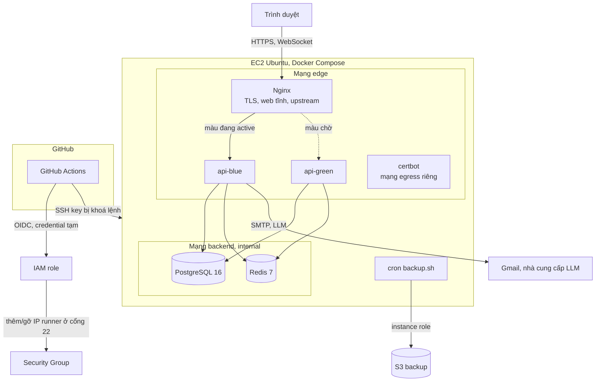
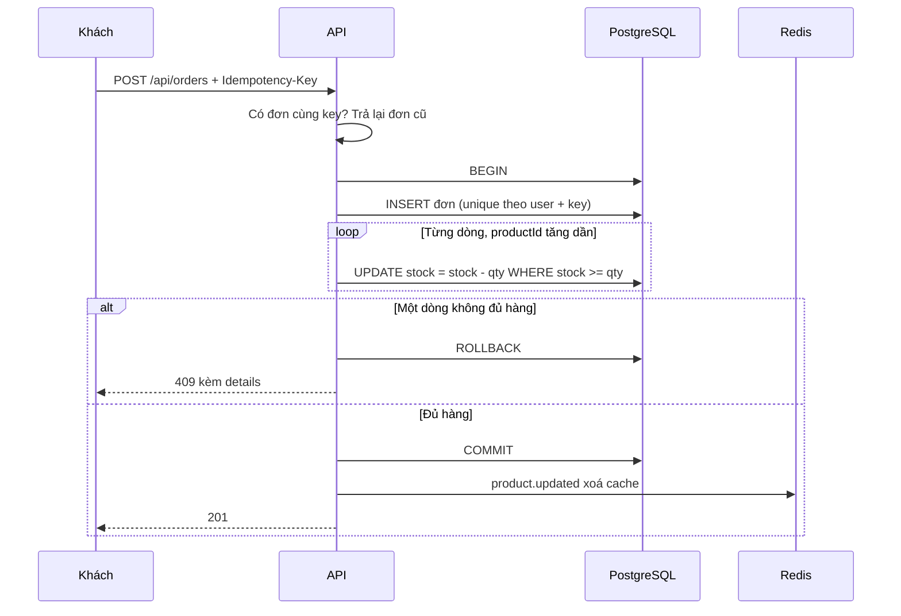
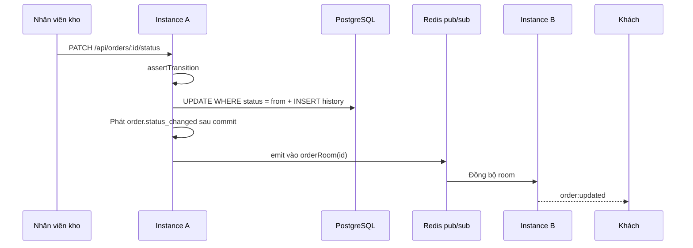
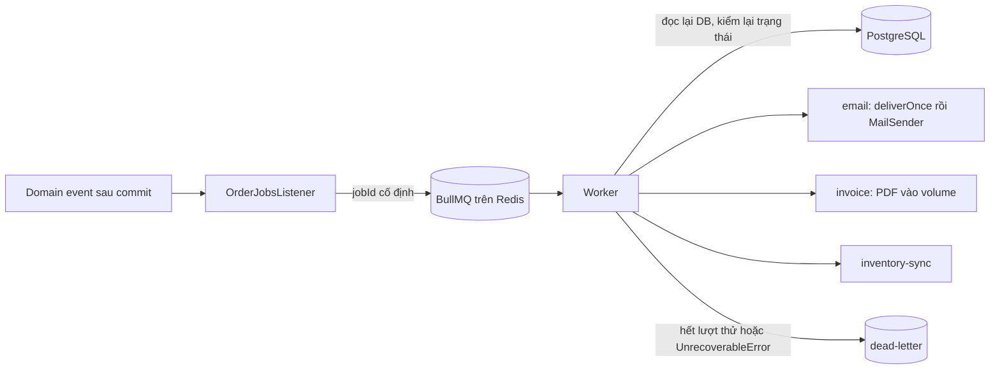
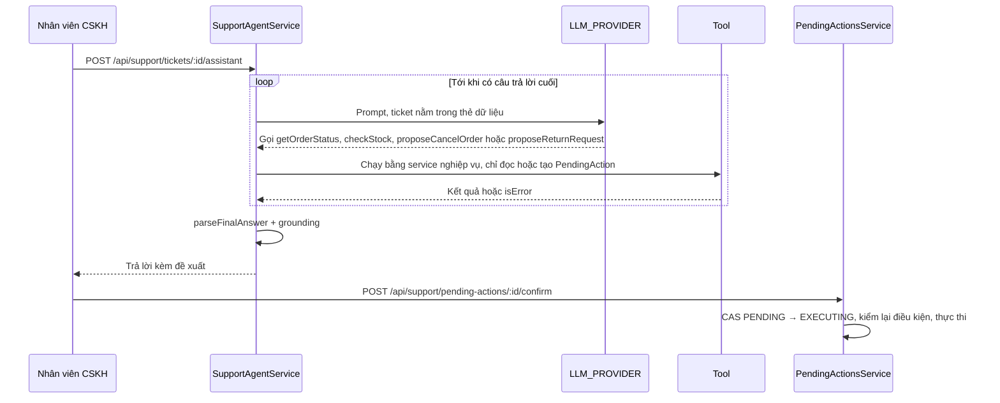
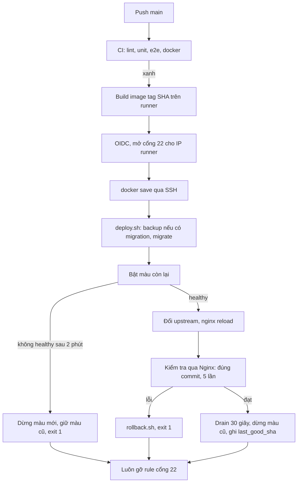

# Kiến trúc ShopFast

Backend thương mại điện tử (NestJS, PostgreSQL, Redis) chạy trên một EC2. Quyết định chi tiết nằm ở [docs/adr/](adr/); tài liệu này cho cái nhìn tổng thể.

## Tổng thể trên AWS

Chỉ Nginx có `ports`. Mạng `backend` là `internal: true`, nên Postgres và Redis không có đường ra Internet.

Không dùng ECR và SSM: image đi thẳng từ runner vào máy qua SSH ([ADR-0014](adr/0014-oidc-va-cong-ssh-tam-thoi.md)).

## Luồng dữ liệu

### Đặt đơn

Mã: `orders.repository.ts:128` (sắp xếp), `:153-154` (trừ kho nguyên tử), `:207-208` (P2002, P2028). Chi tiết: [ADR-0005](adr/0005-khoa-ton-kho-khi-dat-hang.md).

### Cập nhật trạng thái đến realtime

Compare-and-set ở `orders.repository.ts:226-227`. Khi nối lại, client subscribe lại và ack trả trạng thái mới nhất (`order-socket.ts:107`), bù sự kiện bị lỡ. Chi tiết: [ADR-0006](adr/0006-state-machine-don-hang.md), [ADR-0010](adr/0010-realtime-socketio-redis-adapter.md).

### Background job: email, hoá đơn, đồng bộ tồn kho

API không chờ job. `jobId` cố định chặn đẩy trùng (`queues.ts:72`), `deliverOnce` giành quyền trong `email_deliveries` trước khi gửi (`email-jobs.service.ts:99`). Chi tiết: [ADR-0009](adr/0009-background-jobs-bullmq.md).

### Agent AI gọi tool

Model không có tool ghi trực tiếp. CAS ở `pending-actions.repository.ts:115-122`. Chi tiết: [ADR-0011](adr/0011-ai-agent-human-in-the-loop.md).

### Deploy

Chi tiết và giới hạn: [ADR-0015](adr/0015-zero-downtime-va-gioi-han.md).

## Thành phần

| Thành phần                  | Dùng cho                          | Lý do chọn                                                                                                             | Phương án đã cân nhắc                                                            |
| --------------------------- | --------------------------------- | ---------------------------------------------------------------------------------------------------------------------- | -------------------------------------------------------------------------------- |
| NestJS 10                   | API                               | Module, DI, guard toàn cục mặc định từ chối                                                                            | Express thuần                                                                    |
| Prisma 6                    | ORM                               | Type an toàn, migration có kiểm soát ([ADR-0001](adr/0001-chon-orm-prisma.md))                                         | TypeORM, Drizzle, SQL thuần                                                      |
| PostgreSQL 16               | Dữ liệu chính                     | Transaction, CHECK, UPDATE nguyên tử                                                                                   | Giữ tồn kho ở Redis (đã loại, [ADR-0005](adr/0005-khoa-ton-kho-khi-dat-hang.md)) |
| Redis 7                     | Cache, rate limit, queue, pub/sub | Một thành phần cho nhiều nhu cầu, lỗi thì suy giảm được                                                                | Memcached, cache trong process                                                   |
| JWT + refresh xoay vòng     | Xác thực                          | Access ngắn hạn, phát hiện dùng lại refresh ([ADR-0003](adr/0003-quan-ly-refresh-token.md))                            | Session trên server                                                              |
| EventEmitter2               | Domain event                      | Tách listener, phát sau commit ([ADR-0004](adr/0004-domain-event-noi-bo.md))                                           | Outbox, Kafka                                                                    |
| BullMQ                      | Job nền                           | Retry, backoff, Bull Board ([ADR-0009](adr/0009-background-jobs-bullmq.md))                                            | Gọi đồng bộ, RabbitMQ                                                            |
| Socket.IO + Redis adapter   | Realtime                          | Tự nối lại, room qua nhiều instance ([ADR-0010](adr/0010-realtime-socketio-redis-adapter.md))                          | SSE, polling                                                                     |
| LLM qua `LLM_PROVIDER`      | Trợ lý CSKH                       | Đổi nhà cung cấp không sửa nghiệp vụ, người xác nhận thao tác ghi ([ADR-0011](adr/0011-ai-agent-human-in-the-loop.md)) | Cho agent ghi trực tiếp                                                          |
| Nginx                       | TLS, proxy, web tĩnh              | Reload không rớt request, đổi upstream bằng file ([ADR-0013](adr/0013-trien-khai-production-blue-green.md))            | ALB, Traefik                                                                     |
| Docker Compose trên một EC2 | Chạy production                   | Rẻ, đủ cho đồ án                                                                                                       | ECS, Kubernetes                                                                  |
| GitHub Actions + OIDC       | CI/CD                             | Không có access key dài hạn ([ADR-0014](adr/0014-oidc-va-cong-ssh-tam-thoi.md))                                        | SSM, self-hosted runner                                                          |
| S3                          | Backup ngoài máy                  | Sống sót khi mất EC2 ([ADR-0016](adr/0016-backup-postgres-len-s3.md))                                                  | EBS snapshot, tải về máy cá nhân                                                 |
| React + Vite + Tailwind     | UI demo                           | Build tĩnh, phục vụ qua Nginx                                                                                          | Next.js                                                                          |
